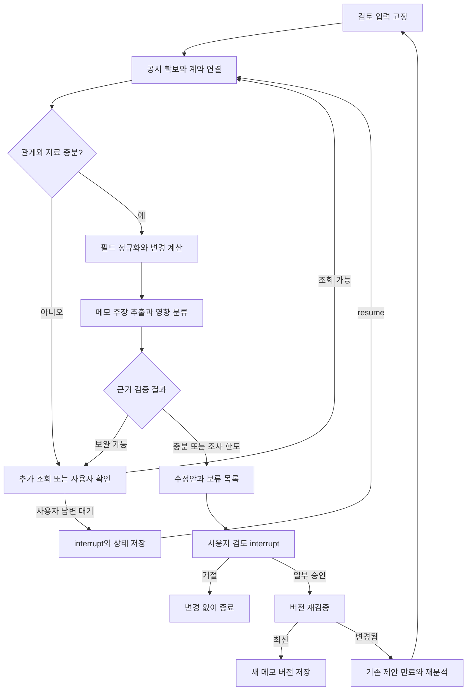

# 공시 정정 영향 추적 에이전트 — MVP 기획서

작성일: 2026-09-15

## 1. 제품 정의

프로젝트명(가칭): 공시체크 — 내 분석 메모의 수정이 필요한 문장을 찾는 에이전트

한 문장: 정정 공시가 들어오면 이전 공시와 비교하고, 사용자가 작성한 기업분석 메모에서 수정하거나 다시 검토해야 할 주장을 근거와 함께 찾아준다.

핵심 결과물은 ‘문장별 영향 검토표 + 사용자가 승인한 새 메모 버전’이다.

대상 사용자는 공급계약 공시를 근거로 짧은 기업분석 메모를 관리하는 리서치 보조 담당자다. 한 사용자가 한 기업의 한 계약과 관련된 메모 하나를 검토하는 상황부터 시작한다.

### 해결하려는 문제

- 공시 정정 알림을 받아도 자신이 쓴 어느 문장에 영향이 있는지 다시 찾아야 한다.
- 금액뿐 아니라 기간·상대방 변경이 서술형 주장에 영향을 준다.
- 이미 수정된 메모를 다시 고치거나, 같은 회사의 다른 계약과 혼동할 수 있다.
- 계약 변경만으로 실적·주가 영향을 단정하면 오히려 잘못된 분석을 만든다.

사용자 효용 가설: ‘정정 공시와 메모를 번갈아 읽는 시간’을 줄이면서, 수정 누락과 불필요한 수정을 함께 줄인다. 실제 시간 절감은 사용자 실험 전에는 성과로 주장하지 않는다.

## 2. 범위

### 포함

- 국내 상장사 단일판매·공급계약 체결 공시와 그 기재정정. 첫 실증은 한 가지 확인된 양식군으로 제한한다.
- 사용자 등록 메모: 한국어 일반 텍스트/Markdown, 기본 최대 5,000자. 한 메모에는 서로 다른 계약 문장이 섞일 수 있다.
- 이전 공시와 정정 공시 각 1개를 입력하는 수동 비교가 기본 경로다.
- 정정 연쇄 검증: 최초 → 1차 → 2차처럼 3개 이상인 사례를 포함한다. 모든 과거 공시의 자동 수집을 약속하지 않는다.
- 핵심 필드: 계약 금액, 계약 시작일·종료일, 계약 상대방.
- 계산 보조 필드: 공시에 있는 최근 매출액, 매출액 대비 비율, 통화·단위·회계연도·연결/별도·부가세 등 비교 기준.
- 문장 내 주장을 분리해 직접 변경, 계산 영향, 해석 재검토, 영향 없음, 판단 보류로 분류한다.
- 승인한 사실 수정만 새 메모 버전으로 저장한다. 기존 메모는 보존한다.
- 보완 자료·계약 선택 대기와 재개, 근거 표시, 진행 상태 저장.
- 수동 ‘정정 확인’ 버튼과 선택적 OpenDART 연동. 확인 범위와 기준 시점을 표시한다.

### 제외

- 주가 예측, 매수·매도 추천, 목표주가 계산, 실적 자동 추정.
- 모든 공시 유형, 모든 문서 양식, 스캔 PDF OCR, 긴 증권사 보고서 전체 편집.
- 외환 환산 추정, 매출 인식 시점 자동 확정, 지분법·연결 실적 자동 영향 계산.
- 메일/메신저 자동 발송, 실제 외부 문서 덮어쓰기, 다중 사용자 인증, 실시간 상시 감시.
- 필수 벡터 DB와 다중 에이전트. 작은 메모는 전체 주장 검토를 기본으로 한다.

## 3. 대표 사용 시나리오

다음은 가상 기업·가상 데이터다.

이전 공시: A사의 장비 공급계약 120억원, 계약 종료일 2026-12-31, 최근 매출액 800억원(2025년 연결 기준).

정정 공시: 같은 계약의 금액 90억원, 종료일 2027-03-31. 매출액 기준은 동일.

등록 메모:

1. A사는 B사와 120억원 규모의 장비 공급계약을 체결했다.
2. 계약 규모는 2025년 연결 매출액의 15%에 해당한다.
3. 계약은 2026년 말 종료될 예정이다.
4. 따라서 계약 금액 전액이 2026년 매출로 반영될 전망이다.
5. A사는 산업용 장비 제조업체다.

예상 결과:

| 문장 | 분류 | 결과 |
| --- | --- | --- |
| 1 | 직접 사실 변경 | 120억원 → 90억원 수정안. 상대방은 유지 |
| 2 | 계산 영향 | 90/800×100 = 11.25%. 분모 기준이 같음을 확인하고 수정안 |
| 3 | 직접 사실 변경 | 종료 예정일을 2027-03-31로 수정 |
| 4 | 해석 재검토 | 계약 기간만으로 매출 인식 시점을 확정할 수 없음. 자동 수정 제외 |
| 5 | 영향 없음 | 이번 정정의 지원 범위에서 연결된 변경이 발견되지 않음 |

‘영향 없음’은 메모 내용 전체의 진실성을 검증했다는 뜻이 아니다. 파싱 실패나 검토 누락이 있으면 이 판정을 사용하지 않는다.

사용자가 문장 1~3의 수정안을 선택하고 저장하면 메모 v2가 생성된다. 문장 4의 재검토 표시는 검토 이력에 남는다. 원문 문서와 메모 v1은 유지한다.

## 4. 핵심 판단 규칙

### 4.1 같은 계약인지 먼저 확인

- 회사 고유번호와 공시 제목만 같다고 같은 계약으로 처리하지 않는다.
- 정정 대상 제출일, 원문 관련 공시 링크, 계약 내용, 상대방, 계약일 등을 함께 사용한다.
- ‘가장 최근의 같은 제목’만으로 이전 문서를 선택하지 않는다.
- 확실한 관계와 후보 관계를 구분한다. 후보가 여러 개면 사용자에게 선택을 요청한다.
- 사용자의 수동 선택은 ‘사용자 확인 관계’로 기록하며, 상충하는 근거가 있으면 명시한다.
- 모회사와 자회사, 계약 주체가 불명확하면 자동 연결하지 않는다.

### 4.2 비교 기준을 보존

- 원문 값, 정규화 값, 단위, 통화, 기준 기간, 근거 위치를 같이 저장한다.
- Decimal 또는 원 단위 정수를 사용한다. 날짜는 날짜 타입을 사용한다.
- ‘-’, 미공개, 유보, 파싱 실패, 0은 별도 상태다.
- 120억원과 12,000,000,000원은 동등하게 처리한다.
- 통화·부가세·확정/조건부 금액 등 의미 기준이 다른 경우 단순 숫자 비교를 보류한다.
- 매출액 대비 비율은 ‘공시 기재 비율’과 ‘서버 재계산 비율’을 분리한다. 공시 비율의 반올림 정책을 추측하지 않는다.
- 원문끼리 정정표·수정 본문이 충돌하면 한쪽을 조용히 채택하지 않고 판단 보류한다.

### 4.3 공시 변화와 메모 변화는 다르다

- 문서 변화: 직전 관련 공시와 이번 공시의 차이.
- 메모 영향: 현재 메모의 주장과 이번 공시의 사실 사이의 관계.
- 메모가 이미 90억원을 반영했다면 같은 정정에 대해 중복 수정하지 않는다.
- 역사적 표현 ‘최초 계약 당시 120억원이었다’는 그대로 참일 수 있다. 현재 금액 문장과 구별한다.
- 하나의 문장에 여러 주장이 있으면 각각 판단하고, 문장 수정은 중복·겹침 없이 합성한다.
- 다른 계약을 다루는 문장, 이미 최신인 문장, 정정과 무관한 문장을 보존한다.

### 4.4 결과 분류

| 코드 | 화면 표현 | 조건 | 수정안 처리 |
| --- | --- | --- | --- |
| DIRECT_FACT_CHANGE | 사실 수정 필요 | 해당 계약의 명시 사실과 현재 주장이 불일치 | 근거 검증 후 제안 |
| DERIVED_VALUE_CHANGE | 계산값 수정 필요 | 계산식과 모든 입력 기준이 확인됨 | 서버 계산값으로 제안 |
| INTERPRETATION_REVIEW | 해석 재검토 | 변경이 전망·추론의 전제와 관련됨 | 검토 메모만 제공, 일괄 자동 수정 제외 |
| NO_IMPACT | 이번 정정 영향 없음 | 지원 범위 검토가 완료됐고 영향 연결 없음 | 변경하지 않음 |
| UNRESOLVED | 판단 보류 | 계약·근거·추출·비교 기준이 불충분 | 자료 또는 확인 요청 |

오류·미검토를 NO_IMPACT로 바꾸지 않는다. 전체 결과에는 검토한 주장 수, 미검토/판단 보류 수를 함께 표시한다.

## 5. 에이전트와 일반 코드의 분담

### LLM

- 메모에서 사실·계산·전망 주장을 구조화한다.
- 변경 필드와 주장 사이의 의미 관계를 분류한다.
- 불확실성을 해소하기 위해 허용된 조회 중 다음 행동을 선택한다.
- 검증된 사실과 계산 결과에 근거해 수정안·확인 질문을 작성한다.

### 일반 코드

- API 요청, 원문 저장·해시, 안전한 파일 처리, 구조 파싱.
- 숫자·단위·날짜 정규화와 계산.
- 인용 위치가 실제 원문에 존재하는지 확인.
- 계약 연결의 확정 조건, 행동 허용 목록, 재시도·조회 한도.
- 승인·문서 버전 검증과 새 메모 저장.

단순 문자열 인용 검사는 근거가 주장을 뒷받침한다는 보증이 아니다. 구조화 필드의 일치 검증과 별도 의미 평가를 함께 수행한다. 모델이 선언한 confidence만으로 계약 관계나 수정안을 확정하지 않는다.

### 허용할 조사 행동

- LOAD_RELATED_FILING: 확인된 후보 목록에서 관련 공시 읽기.
- READ_EVIDENCE_BLOCK: 보존된 문서의 표·주석·문단 읽기.
- ASK_USER: 비교 계약 선택, 누락된 출처 요청.
- FINISH: 근거 충족 또는 한도 도달 시 결과 정리.

서버가 행동과 인자를 검증한다. 모델이 임의 URL, SQL, 셸 명령을 실행하도록 하지 않는다. 같은 행동·근거를 반복하면 중단하고 미해결 사유를 남긴다. 한 검토의 조회 횟수·LLM 호출 수는 설정 가능하게 한다.

## 6. LangGraph 설계

그래프는 조건에 따라 필요한 근거를 더 읽고, 사용자 확인 후 이어서 진행한다. LangGraph는 `StateGraph`, 조건부 간선, 영속 체크포인터, `interrupt`/`resume`으로 실제 사용한다.

검토 상태에는 review_id, thread_id, 원문 해시, 공시 관계, 메모 버전, 필드 변화, 주장, 근거, 제안, 보류 이유, 행동 이력, 호출 횟수, 승인 대상 버전을 저장한다. 원문 대용량 파일을 그래프 상태에 반복 복제하지 않고 참조를 저장한다.

재개와 노드 재실행은 발생할 수 있으므로 메모 버전 저장을 트랜잭션과 안정된 저장 키로 보호한다. 그래프 저장과 업무 데이터 저장이 항상 하나의 트랜잭션이라고 가정하지 않는다.

## 7. 데이터 확보 전략

### 먼저 검증할 사실

OpenDART 공시검색과 원본파일 API의 존재는 공식 문서로 확인했다. 다만 이 기획 작업에서는 인증키로 대상 계약 공시 원문을 다운로드하거나 실제 정정 쌍을 파싱하지 않았다. 따라서 ‘모든 대상 공시를 해당 API에서 가져올 수 있다’고 가정하지 않는다.

첫 개발 단계에서 대표 정정 쌍 3건의 원문 접근과 양식을 확인한다. 각 건에 검색 성공, 본문 확보 성공, 표 추출 성공, 계약 연결 확인을 따로 기록한다.

### 두 가지 입력 경로

1. 기본: 사용자가 정정 전후 HTML/XML/TXT를 등록한다. 외부 원문은 렌더링 시 스크립트를 실행하지 않는다.
2. 선택: OpenDART에서 공시 목록과 원문을 조회하고 캐시한다. 미제공 원문은 사용자 업로드로 보완한다. 무단 우회 수집을 구현하지 않는다.

공시 목록의 `last_reprt_at=N`은 정정을 포함한 제출 이력 수집에 사용한다. 페이지네이션, 조회 기간 제한, 오류 코드, 재시도 정책을 공식 문서와 대조한다. 목록 API에 이전 공시 관계가 항상 직접 제공된다고 가정하지 않는다.

### 데이터 출처 관리

- 실제 공시: 접수번호, 원문 URL, 수집 시각, 파일 해시, 확보 방식, 파서 버전.
- 사용자 문서: 원본 파일명, 문서 유형, 제공된 접수번호, 출처 검증 여부, 해시.
- 합성 문서: synthetic 표시, 시나리오 ID, 생성 방식. 실제 기업의 사실처럼 표시하지 않음.
- 메모: 사용자가 작성한 것인지 평가용으로 만든 것인지 구분.

캐시 시점의 ‘확인된 최신’과 시장 전체의 ‘최신’을 구분한다. 오프라인 모드에서 최신 공시라고 단정하지 않는다. 실제 원문 배포·재사용 조건을 확인하고, 배포가 불명확한 원문은 로컬 캐시와 수집 설명으로 관리한다.

## 8. 화면

단일 검토 화면:

1. 상단: 데이터 모드, LLM 모드, 확인 기준 시각, 회사·계약·메모 버전.
2. 입력: 이전 공시·정정 공시 선택/업로드, 메모 입력, 검토 시작.
3. 왼쪽: 원본 메모와 영향 문장 강조.
4. 오른쪽: 문장별 분류, 정정 전후 값, 근거 표/문단, 수정안.
5. 보류 영역: 부족한 자료와 확인 질문, 자료 추가 후 재개.
6. 하단: 수정안 개별 선택, 새 버전 미리보기, 저장/거절.
7. 이력: 원문·메모 버전과 검토 이벤트. 모델의 내부 추론은 표시하지 않는다.

제품 화면의 대표 설명: ‘정정 공시를 기준으로 메모에서 다시 확인할 문장을 찾습니다.’

## 9. 기술 구성

- Python 3.11 이상 중 환경과 의존성에 맞는 버전.
- LangGraph: 상태 분기, 조사 반복, 중단·재개.
- Pydantic: 구조화 입력·출력과 도구 행동 검증.
- SQLite: 검토·메모·승인 이력. 호환되는 영속 체크포인터 사용.
- FastAPI: 검토 생성·진행·보완·승인·결과 API.
- Streamlit: 한국어 데모 화면. UI는 백엔드 API만 호출.
- HTML/XML 파서: 구조와 표 셀·문단 근거 위치 보존. 실제 자료 확인 후 선정.
- pytest: 계산·파싱·버전·그래프 테스트.
- LLM 공급자 교체 인터페이스. OpenAI 사용 시 모델명과 키는 환경변수.

DATA_MODE=fixture|dart, LLM_MODE=fake|openai를 독립 설정한다. fake는 결정적인 테스트 대역이며 의미 분석 성능 검증용이 아니다. 실제 공시+fake, 합성 자료+실제 LLM 등의 조합을 보고서에서 구분한다.

## 10. 평가

### 초기 데이터셋 제안

- 최소 12개 시나리오, 총 60개 이상의 주장.
- 개발 8개와 고정 평가 4개로 분리. 동일 계약 정정 연쇄는 같은 분할에 둔다.
- 변형 표현만 바꾼 동일 사례를 양쪽에 넣지 않는다.
- 실제 공시 쌍은 확보한 만큼 별도 집계하고, 합성 시나리오와 성능을 합쳐 실제 성능으로 보고하지 않는다.
- 평가 정답은 구현과 분리해 근거와 함께 저장한다. LLM이 만든 정답은 임시 정답이며 사람 검토 전까지 확정 정답으로 표시하지 않는다.

### 필수 사례

금액 변경, 기간 변경, 상대방 변경, 표기만 변경, 동일 회사의 다른 계약, 반복 정정, 이미 최신인 메모, 역사적 서술, 계산 분모 변경, 미공개 값, 상충하는 원문, 매출 인식 추론, 한 문장 내 복수 주장, 원문 내 지시문, 관련 문서 누락.

### 지표

- 영향 주장 precision/recall: 수정·재검토 대상으로 찾아야 하는 주장을 얼마나 정확히 찾는가.
- 분류별 혼동표와 판단 보류 비율: 전부 보류해서 정확도만 높아 보이는 문제 방지.
- 근거 정확성: 존재하는 위치인가와 해당 주장을 실제로 뒷받침하는가를 별도 평가.
- 수정안 충실성: 관련 없는 절을 바꾸거나 새로운 사실을 추가하지 않는가.
- 완료 시간과 LLM 호출 수/사용량. 실제 기록만 보고한다.

비교 기준: 같은 입력을 사용하는 단순 필드 diff+키워드 매칭, 추가 조회 없는 단일 LLM 호출, LangGraph 조사 흐름. 모델·입력 범위·호출 비용을 기록하고 성능 향상을 미리 주장하지 않는다.

제안 목표: 고정 평가에서 영향 주장 recall 90% 이상, precision 85% 이상. 작은 표본의 개발 목표이지 제품 보증이 아니다. 실측 미달은 그대로 보고한다.

필수 시스템 조건: 승인 없는 메모 변경, 다른 검토 건 승인 적용, 중복 저장, 근거 없는 계산 입력 사용은 정의된 회귀 테스트에서 0건. 이는 미지의 모든 입력에 대한 무오류 보증이 아니다.

## 11. 3분 시연

- 0:00~0:30: 계약 공시와 5문장 메모를 보여준다.
- 0:30~1:10: 금액·기간 정정을 분석해 사실·계산·해석을 구분한다.
- 1:10~1:50: 누락 근거 때문에 판단 보류된 항목에 자료를 추가하고 재개한다.
- 1:50~2:30: 원문 근거와 수정안을 확인하고 일부만 승인해 메모 v2를 저장한다.
- 2:30~3:00: 같은 정정을 다시 넣어 이미 반영된 문장을 재수정하지 않는 것을 보여준다.

핵심 메시지: ‘바뀐 공시를 요약하는 데서 끝나지 않고, 내 문서의 어느 주장을 고쳐야 하는지 근거와 함께 연결한다.’

## 12. 참고 문서와 검증 범위

- [OpenDART 공시검색](https://opendart.fss.or.kr/guide/detail.do?apiGrpCd=DS001&apiId=2019001): 검색 조건과 이력 조회.
- [OpenDART 공시서류 원본파일](https://opendart.fss.or.kr/guide/detail.do?apiGrpCd=DS001&apiId=2019003): 인증키·접수번호, ZIP 응답과 오류 코드.
- [LangGraph Interrupts](https://docs.langchain.com/oss/python/langgraph/interrupts): 상태 보존과 중단·재개, 노드 재실행 유의사항.
- [OpenAI 공식 프롬프팅 문서](https://learn.chatgpt.com/docs/prompting): 작업 목표·맥락·결과·검증을 명시하는 프롬프트 구성 참고.

확인한 것은 공식 문서다. 이 산출물은 기획과 개발 프롬프트이며, API 연동·앱 구현·LLM 성능 시험은 아직 수행하지 않았다.
